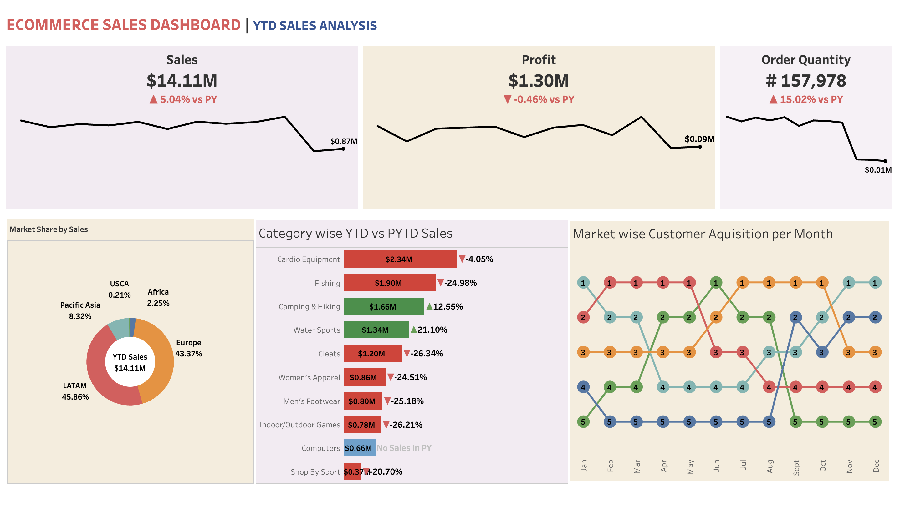

# 🛒 E-Commerce YTD Sales & Customer Analytics Dashboard

## 📌 Executive Summary
An executive-level Tableau dashboard designed to monitor global e-commerce performance, evaluate Year-To-Date (YTD) vs. Prior Year-To-Date (PYTD) metrics, analyze regional market shares, and track product category profitability. 

🔗 **[View Live Interactive Dashboard on Tableau Public](https://public.tableau.com/app/profile/afroj.khan/viz/Ecommercesalesdashboard_17941251450570/Dashboard1)**

---

## 🎯 Key Business Metrics & Performance Indicators (KPIs)
- **Total YTD Sales:** **$14.11M** (▲ **+5.04%** vs PY)
- **Total YTD Profit:** **$1.30M** (▼ **-0.46%** vs PY)
- **Total Order Quantity:** **157,978** (▲ **+15.02%** vs PY)
- **Regional Market Share:** 
  - **LATAM:** **45.86%** of total revenue.
  - **Europe:** **43.37%** of total revenue.
  - **Pacific Asia, Africa, & USCA:** Account for remaining **~10.77%**.
- **Category Profitability Alert:** 
  - **Growth Drivers:** *Water Sports* (▲ **+21.10%**) and *Camping & Hiking* (▲ **+12.55%**).
  - **Declining Categories:** *Cleats* (▼ **-26.34%**), *Indoor/Outdoor Games* (▼ **-26.21%**), and *Men's Footwear* (▼ **-25.18%**) showed significant revenue drop despite steady order volume, signaling aggressive discounting or margin compression.

---

## 📸 Dashboard Preview


---

## 💡 Key Business Recommendations
1. **Optimize Discounting in Low-Margin Categories:** High order volumes in categories like *Cleats* and *Indoor/Outdoor Games* are being offset by shrinking margins. Re-evaluating promotional pricing will help restore profitability.
2. **Capitalize on LATAM & European Expansion:** With LATAM and Europe driving nearly **90%** of total sales, double down on local supply chain logistics and marketing spend in these primary corridors.
3. **Growth Focus on High-Performing Categories:** Increase inventory allocation for *Water Sports* and *Camping & Hiking* to meet growing seasonal demand.

---

## 🛠️ Tools & Technologies Used
- **Tableau Public / Desktop:** Interactive dashboard development, calculated fields, YoY variance tracking, dynamic visual layouts.
- **Data Preprocessing:** SQL & Python (Pandas) for data validation, missing value handling, and aggregation.
- **Version Control:** GitHub (`Afrojkhan-glitch`) for project documentation and repository management.

---

## 📂 Repository Structure
```text
ecommerce-sales-analytics/
├── assets/
│   └── ecommerce_sales_dashboard.png   # High-resolution dashboard screenshot
├── data/
│   └── Dataset.csv                      # E-commerce retail sales dataset
├── tableau/
│   └── E-Commerce_Sales_Dashboard.twbx  # Tableau Packaged Workbook
├── LICENSE                              # MIT License
└── README.md                            # Executive summary & project documentation
```
###👤 Author

Afroj Ahmad Khan

LinkedIn: linkedin.com/in/afroj-khan-5b32622b0

GitHub: github.com/Afrojkhan-glitch
